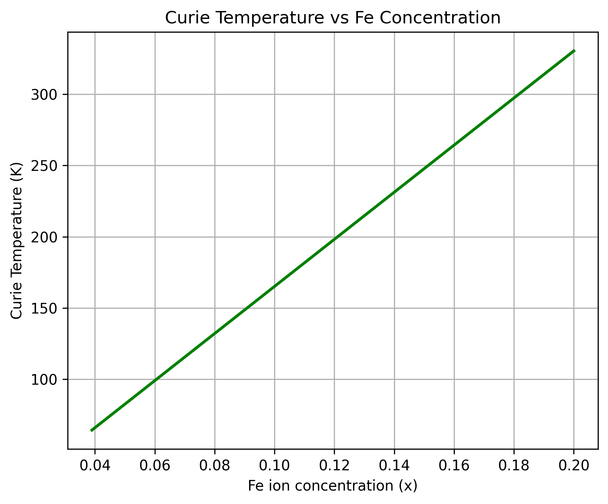
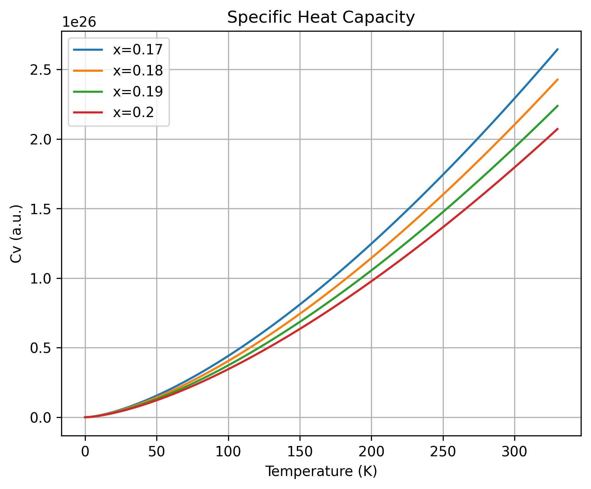
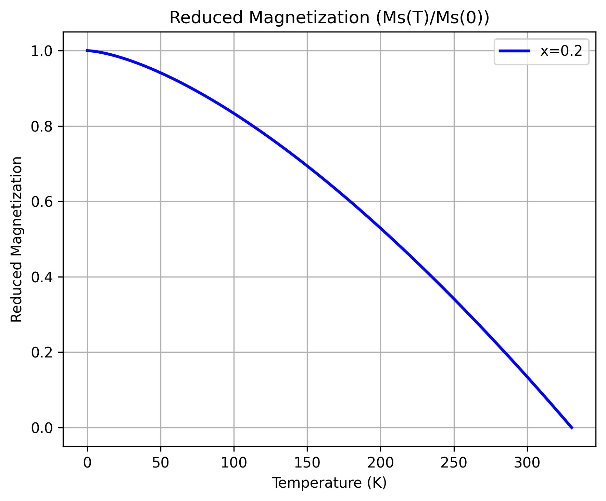

# Mn- and Cr-Doped Diluted Magnetic Semiconductors

This repository contains a Jupyter notebook and a Python script for exploring
temperature-dependent magnetic and thermodynamic quantities in a diluted
magnetic semiconductor (DMS).

## Theoretical basis

The simulations are based on the theoretical framework for Fe-doped GaSb
(`GaSb:Fe`) with `Fe³⁺` ions. This framework provides the physical model and
equations used to study magnetic and thermodynamic behavior in the Mn- and
Cr-doped diluted magnetic semiconductors considered by this project.

## What the simulation calculates

Using a low-temperature magnon model, the notebook calculates and plots:

- The Curie temperature as a function of Fe concentration, for
  `x = 0.039` to `0.2`.
- The magnon heat-capacity trend over `0` to `330 K`, for concentrations
  `x = 0.17`, `0.18`, `0.19`, and `0.20`.
- The reduced magnetization, `Mₛ(T) / Mₛ(0)`, from `0 K` to the calculated
  Curie temperature at `x = 0.2`.

The model uses a Heisenberg exchange description and a quadratic long-wavelength
magnon dispersion. Its parameters in the current implementation include an
exchange constant of `10 meV`, a lattice constant of `6.09 Å`, spin `S = 5/2`,
and carrier density `5 × 10²⁶ m⁻³`.

The heat-capacity calculation is presented in arbitrary units: the notebook
notes that the unit scale depends on unspecified mass units. Treat the plotted
curves as model trends, not as calibrated experimental predictions.

## Repository contents

```text
figures/
  01_Curie_Temperature_vs_Concentration.png
  02_Heat_Capacity_vs_Temperature.png
  03_Reduced_Magnetization_vs_Temperature.png
notebooks/
  01-simulation of Mn- and Cr-doped DMS.ipynb
src/
  01-simulation of Mn- and Cr-doped DMS.py
requirements.txt
```

## Setup

Use Python 3.9 or later. From the repository root, install the dependencies:

```powershell
python -m pip install -r requirements.txt
```

## Run the notebook

Start Jupyter from the repository root:

```powershell
python -m jupyter notebook
```

Open `notebooks/01-simulation of Mn- and Cr-doped DMS.ipynb` and run its cells
in order.

## Run the Python script

The script saves its figures to `../figures` relative to the current working
directory. Run it from the `src` directory so the output is written to the
repository's `figures` directory:

```powershell
Set-Location src
python "01-simulation of Mn- and Cr-doped DMS.py"
```

The script also opens the plots interactively when the selected Matplotlib
backend supports graphical windows.

## Figures

### Curie temperature versus Fe concentration



### Heat capacity versus temperature



### Reduced magnetization versus temperature


