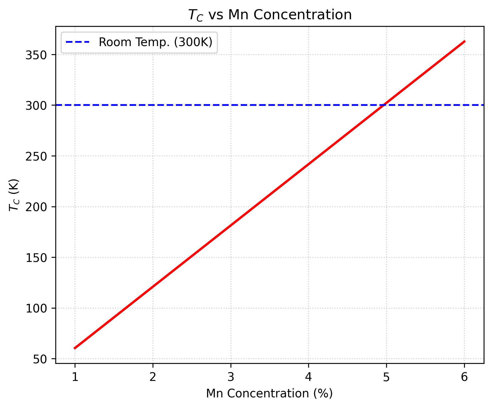
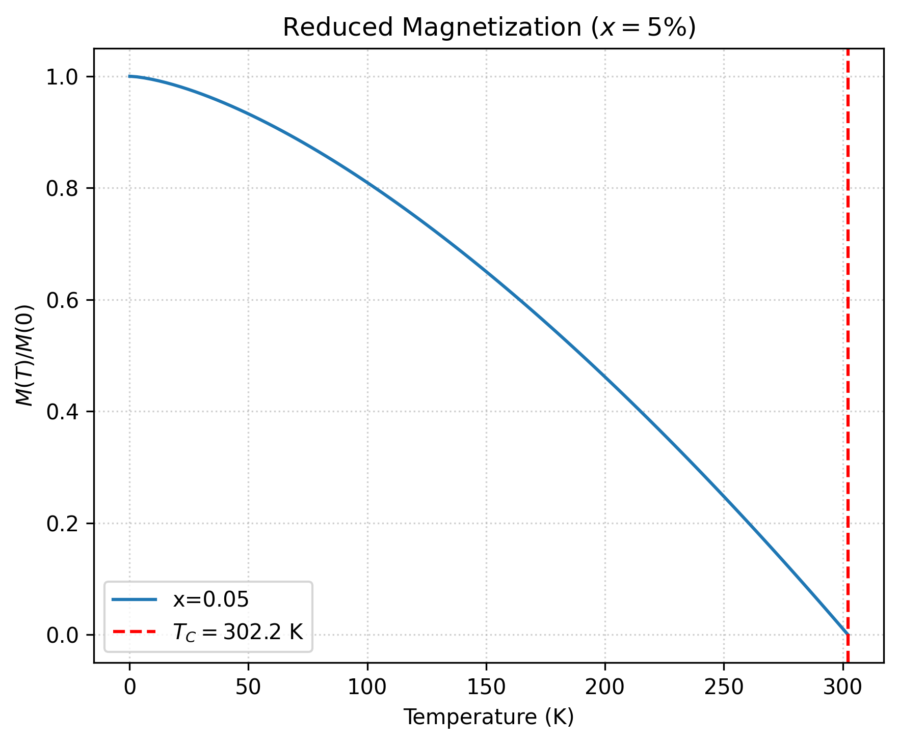
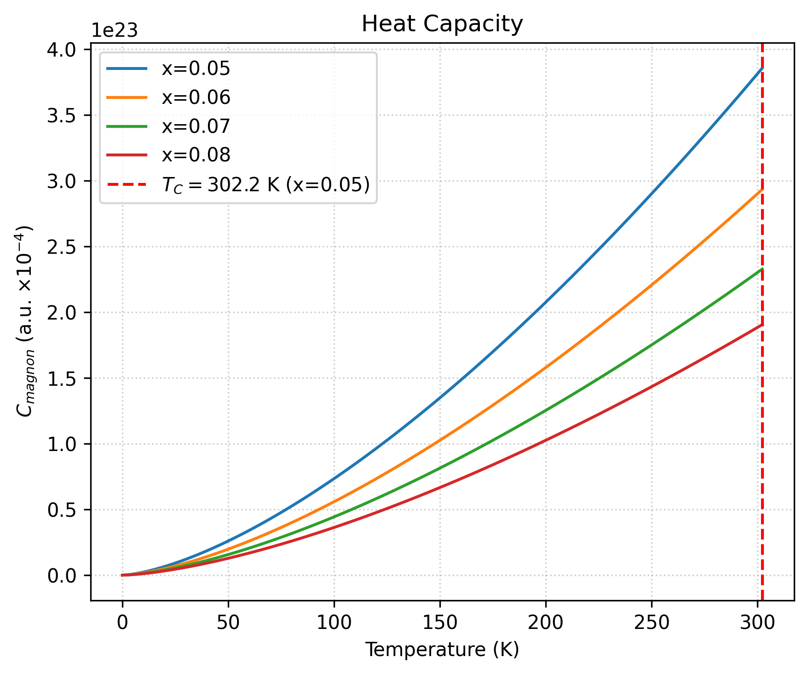

# Mn- and Cr-Doped Diluted Magnetic Semiconductors

This repository contains two Jupyter notebooks and corresponding Python scripts
for exploring temperature-dependent magnetic and thermodynamic quantities in
Diluted Magnetic Semiconductors (DMSs).

## Theoretical basis

The project combines two complementary models:

- A theoretical framework for Fe-doped GaSb (`Ga_{1-x}Fe_xSb`) with `Fe³⁺`
  ions, used to study the magnetic and thermodynamic behavior of the
  semiconductor host.
- A consolidated model for the magnetic properties of Mn-doped wurtzite AlN
  (`Al_{1-x}Mn_xN`), covering the relevant temperature-dependent behavior and
  transition trends in the Mn-containing system.

Together, these notebooks provide a practical set of calculations for
Curie-temperature trends, reduced magnetization curves, and heat-capacity
profiles.

## What the simulations calculate

Using low-temperature magnon and exchange-based models, the notebooks calculate
and plot:

- Curie temperature as a function of dopant concentration.
- Heat-capacity trends over temperature.
- Reduced magnetization curves, `M_s(T) / M_s(0)`, over the relevant
  temperature range.

The model uses Heisenberg-like exchange descriptions and long-wavelength magnon
approximations to capture the qualitative temperature dependence of the
magnetic response.

## Repository contents

```text
figures/
  01_Curie_Temperature_vs_Concentration.png
  02_Heat_Capacity_vs_Temperature.png
  03_Reduced_Magnetization_vs_Temperature.png
  04_Tc_vs_Mn_Concentration.png
  05_Reduced_Magnetization.png
  06_Heat_Capacity.png
notebooks/
  01-Theoretical Framework (Ga_{1-x}Fe_xSb).ipynb
  02-Consolidated Theoretical Model of the Magnetic Properties of Al_{1-x}Mn_xN (Wurtzite).ipynb
src/
  01-Theoretical Framework (Ga_{1-x}Fe_xSb).py
  02-Consolidated Theoretical Model of the Magnetic Properties of Al_{1-x}Mn_xN (Wurtzite).py
requirements.txt
```

## Setup

Use Python 3.9 or later. From the repository root, install the dependencies:

```powershell
python -m pip install -r requirements.txt
```

## Run the notebooks

Start Jupyter from the repository root:

```powershell
python -m jupyter notebook
```

Open either notebook in the `notebooks/` directory and run its cells in order:

- `notebooks/01-Theoretical Framework (Ga_{1-x}Fe_xSb).ipynb`
- `notebooks/02-Consolidated Theoretical Model of the Magnetic Properties of Al_{1-x}Mn_xN (Wurtzite).ipynb`

## Run the Python scripts

Each script saves its figures to the repository's `figures` directory when run
from the `src` folder:

```powershell
Set-Location src
python "01-Theoretical Framework (Ga_{1-x}Fe_xSb).py"
python "02-Consolidated Theoretical Model of the Magnetic Properties of Al_{1-x}Mn_xN (Wurtzite).py"
```

The scripts also open plots interactively when the selected Matplotlib backend
supports graphical windows.

## Figures

### Curie temperature versus Fe concentration


### Heat capacity versus temperature


### Reduced magnetization versus temperature


### Curie temperature versus Mn concentration



### Reduced magnetization



### Heat capacity


